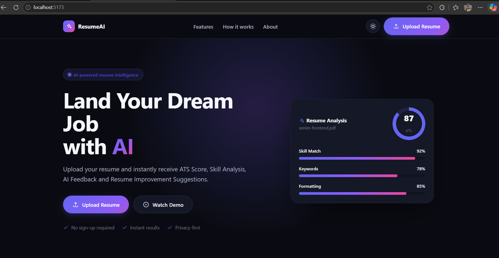
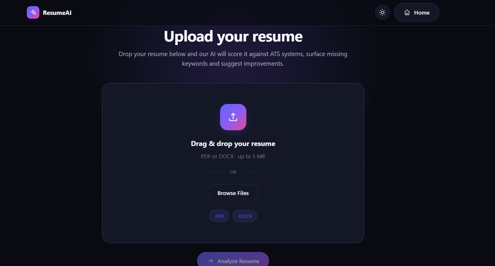
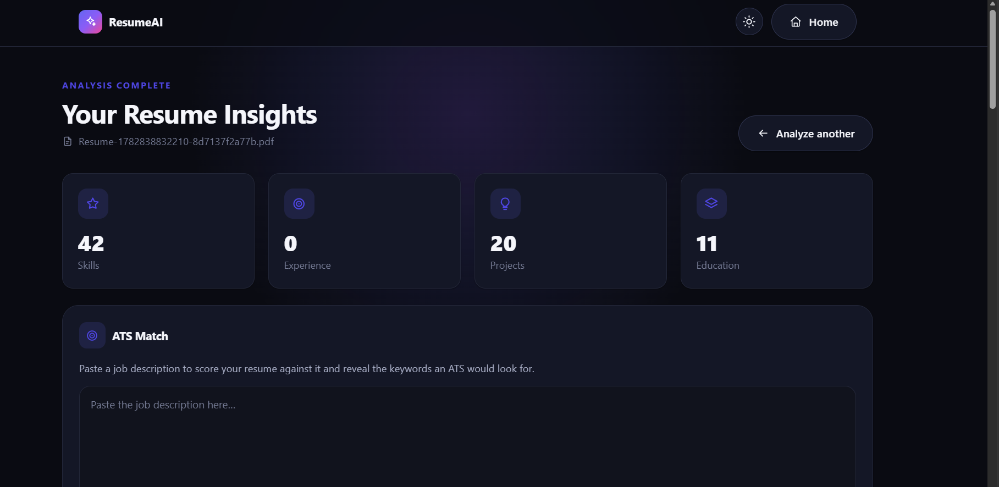
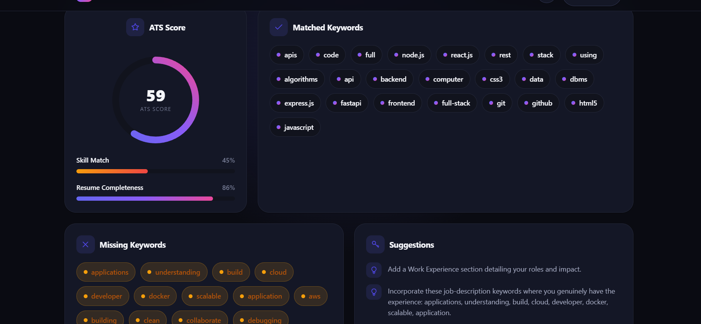

# AI Resume Analyzer

> Upload a resume, parse it into structured data, and score it against any job description with a built-in **ATS (Applicant Tracking System) engine** — no external LLM APIs required.

<p align="center">
  
  
  
  
  
  
</p>

**AI Resume Analyzer** is a production-style, microservice full-stack application that turns a raw resume PDF into actionable, recruiter-grade insights. A Python (FastAPI) microservice extracts structured data **on-device**, an Express backend orchestrates uploads and runs a purpose-built **ATS scoring engine**, and a modern React dashboard visualizes the results — score, skill match, completeness, matched/missing keywords, and concrete suggestions.

Built to demonstrate clean service boundaries, REST API design, deterministic NLP parsing, and real deployment — without depending on any paid LLM API.

---

## Table of Contents

- [🚀 Live Demo](#-live-demo)
- [💡 Why This Project?](#-why-this-project)
- [🌟 Project Highlights](#-project-highlights)
- [✨ Features](#-features)
- [🧱 Tech Stack](#-tech-stack)
- [🏗️ Architecture](#️-architecture)
- [🔄 Project Workflow](#-project-workflow)
- [📸 Screenshots](#-screenshots)
- [⚙️ Installation](#️-installation)
- [📂 Repository Structure](#-repository-structure)
- [🔌 API Endpoints](#-api-endpoints)
- [🔐 Environment Variables](#-environment-variables)
- [☁️ Deployment](#️-deployment)
- [🧗 Challenges Faced](#-challenges-faced)
- [📚 Key Learnings](#-key-learnings)
- [🛣️ Future Improvements](#️-future-improvements)
- [📄 License](#-license)

---

## 🚀 Live Demo

Try the deployed application — each service runs independently on Render:

| Service | Platform | Live URL |
| ------- | -------- | -------- |
| 🖥️ **Frontend** | Render Static Site | [**ai-resume-frontend-fv7v.onrender.com**](https://ai-resume-frontend-fv7v.onrender.com) |
| ⚙️ **Backend** | Render Web Service | [**ai-resume-backend-m3tv.onrender.com**](https://ai-resume-backend-m3tv.onrender.com) |
| 🧠 **Parser** | Render Web Service | [**ai-resume-parser-fhdr.onrender.com**](https://ai-resume-parser-fhdr.onrender.com) |

> [!NOTE]
> The backend and parser are hosted on Render's free tier and may take **~30–60 seconds to wake** from cold start on the first request. Subsequent requests are fast.

---

## 💡 Why This Project?

This project was built as a portfolio-grade full-stack application to demonstrate real-world engineering skills beyond a tutorial CRUD app:

- **Full Stack Development** — end-to-end ownership from UI to API to parser to scoring engine.
- **React + Express + FastAPI integration** — a polyglot stack with three services communicating over HTTP.
- **REST API Design** — clean, predictable endpoints for upload, parsing, health checks, and ATS analysis.
- **Resume Parsing** — deterministic PDF extraction using PyMuPDF, spaCy, and regex (no LLM dependency).
- **ATS Algorithm Design** — keyword normalization, synonym matching, skill match, completeness scoring, and actionable suggestions.
- **Microservice Architecture** — independently deployable frontend, backend, and parser services with clear boundaries.
- **Production Deployment** — live deployment on Render with environment-driven configuration and fail-fast validation.

---

## 🌟 Project Highlights

- 🧩 **Microservice architecture** — three independently deployable services with clean HTTP boundaries.
- ⚛️ **React + Express + FastAPI** — a polyglot stack combining a modern SPA, a Node REST API, and a Python NLP service.
- 📄 **Resume parsing** — deterministic PDF extraction with PyMuPDF + spaCy + regex (no LLM, fully on-device).
- 🎯 **ATS keyword analysis** — synonym-aware normalization, false-positive-safe matching, and a transparent 0–100 score.
- 🔗 **REST APIs** — well-structured endpoints for upload, parsing, and analysis.
- ☁️ **Render deployment** — all three services deployed and wired together in production.

---

## ✨ Features

| Feature                       | Description                                                                                  |
| ----------------------------- | -------------------------------------------------------------------------------------------- |
| 📤 **Resume Upload**          | Drag-and-drop / file-picker upload of a resume PDF from the React UI.                         |
| 📄 **PDF Resume Parsing**     | Extracts contact details, skills, education, experience, and projects (PyMuPDF + spaCy + regex). |
| 🎯 **ATS Score Analysis**     | Computes a real **0–100 ATS score** for a resume against a given job description.             |
| 🧠 **Skill Match**            | Measures how many JD keywords are explicitly backed by your resume's skills.                  |
| ✅ **Resume Completeness**    | Flags missing standard sections (name, email, phone, skills, education, experience, projects). |
| 🔎 **Missing Keyword Detection** | Surfaces exactly which job keywords your resume is missing.                                |
| 💡 **Keyword Suggestions**    | Generates human-readable tips to close gaps before applying.                                 |
| 📈 **Career Trajectory Forecast** | Predicts 1, 3, and 5-year career milestones, promotion velocity index (0-100), and comp bands. |
| 🌟 **STAR Story Matrix**       | Transforms raw resume bullets into FAANG/Amazon-grade behavioral interview stories with interviewer traps. |
| 🛡️ **Blind ATS De-Biasing**    | Audits blind screening score, analyzes linguistic balance (agentic vs communal), and offers neutral rewrites. |
| 🎙️ **Executive Persona Studio** | Crafts multi-channel branding personas: 30-sec elevator pitch, LinkedIn About, conference bio, and founder pitch. |
| ⚡ **7-Day Interview Sprint**   | Generates an intensive day-by-day interview bootcamp curriculum with drill questions and reverse interview prompts. |
| 🌍 **Global Resume Localization** | Adapts resume format, tone, and conventions across US, UK/EU, UAE/Middle East, and APAC markets. |
| 💻 **Resume Terminal CLI**    | Embedded interactive developer terminal with ASCII art and command-line execution of all AI engines. |
| ⌨️ **Command Palette (⌘K)**   | Spotlight search for instant keyboard-driven navigation across all analysis modes and tools. |
| 🐍 **FastAPI Parser**         | Dedicated Python microservice for fast, deterministic PDF parsing.                            |
| 🔌 **Express REST API**       | Node/Express backend orchestrating uploads, parsing, and ATS scoring.                         |
| ⚛️ **Modern React UI**        | Animated score ring, progress bars, keyword tags, light/dark theming.                        |
| 📱 **Responsive Design**      | Works cleanly across desktop, tablet, and mobile viewports.                                   |


---

## 🧱 Tech Stack

### Frontend
- **React 19** + **Vite 8**
- **React Router 7** for routing
- **Axios** for API calls
- Hand-rolled CSS design system (no UI framework) with light/dark theming

### Backend (API + ATS Engine)
- **Node.js** + **Express 4**
- **Multer** for file uploads
- **Axios + form-data** to forward files to the parser
- **Helmet**, **CORS**, **Morgan** for security & logging

### Parser
- **Python 3.9+** + **FastAPI** + **Uvicorn**
- **PyMuPDF** for PDF text extraction
- **spaCy** (`en_core_web_sm`) for NLP / name detection
- **Pydantic** for schema validation

### Database
- **MongoDB** + **Mongoose** for upload metadata (optional / best-effort — the backend runs fine without it)

### Deployment
- **Render** — separate services for frontend (static site), backend (web service), and parser (web service)
- Environment-driven configuration with production-safe validation (no hardcoded localhost)

---

## 🏗️ Architecture

The system is split into three independently runnable services and flows in one direction from a raw PDF to an actionable dashboard:

```
              Resume PDF
                  │
                  ▼
           React Frontend            (Vite SPA · upload + dashboard)
                  │  POST /api/upload
                  ▼
           Express Backend           (REST API · orchestration)
                  │  forward file → POST /parse
                  ▼
        FastAPI Resume Parser        (PyMuPDF + spaCy + regex)
                  │
                  ▼
       Structured Resume JSON        (contact, skills, education, ...)
                  │  POST /api/ats/analyze
                  ▼
             ATS Engine              (keyword match · skill match · scoring)
                  │
                  ▼
              Dashboard              (score, matched/missing keywords, tips)
```

> [!TIP]
> Upload metadata is persisted to **MongoDB** on a best-effort basis. If the database is unavailable, parsing and ATS analysis still work — persistence is simply skipped.

**Request flow:**

1. The user uploads a resume PDF in the React app → `POST /api/upload`.
2. Express stores upload metadata (if MongoDB is available) and forwards the file to the Python parser's `POST /parse`.
3. The parser returns structured resume JSON, which Express relays back to the frontend dashboard.
4. On the dashboard, the user pastes a **job description** → `POST /api/ats/analyze`.
5. The Express **ATS engine** scores the parsed resume against the job description and returns the score, matched/missing keywords, completeness, and suggestions.

> The ATS engine (`backend/src/services/atsService.js`) is pure, dependency-free, and modular — keyword extraction, normalization, matching, skill match, completeness, scoring, and suggestions are each isolated, testable functions.

---

## 🔄 Project Workflow

End-to-end flow from a user's perspective:

```
Upload Resume
      │
      ▼
Backend Upload API          (POST /api/upload)
      │
      ▼
FastAPI Parser              (POST /parse)
      │
      ▼
Structured Resume JSON      (contact, skills, education, experience, projects)
      │
      ▼
ATS Engine                  (POST /api/ats/analyze)
      │
      ▼
Dashboard                   (score, matched/missing keywords, suggestions)
```

---

## 📸 Screenshots

| Landing Page | Upload Flow |
| --- | --- |
|  |  |

| Dashboard — Parsed Insights | ATS Match — Score & Keywords |
| --- | --- |
|  |  |

---

## ⚙️ Installation

### Prerequisites

- **Node.js** 18+ and npm
- **Python** 3.9+
- **MongoDB** (optional — the backend runs without it; upload metadata persistence is skipped if unavailable)

Clone the repository:

```bash
git clone https://github.com/arpitchauhan19/AI-Resume-Analyzer.git
cd AI-Resume-Analyzer
```

You'll run **three** services. Open three terminals (one per service).

### 1. Python Parser

```bash
cd python-service

# Create & activate a virtual environment
python -m venv venv
# Windows (PowerShell)
venv\Scripts\Activate.ps1
# macOS / Linux
# source venv/bin/activate

pip install -r requirements.txt

# One-time: download the spaCy English model
python -m spacy download en_core_web_sm

# Run on http://localhost:8000
uvicorn app:app --reload --port 8000
```

### 2. Express Backend

```bash
cd backend

npm install

# Configure environment
cp .env.example .env   # Windows: copy .env.example .env

# Run on http://localhost:5000
npm run dev
```

### 3. React Frontend

```bash
cd frontend

npm install

# Configure environment (optional in dev; required for production builds)
cp .env.example .env   # Windows: copy .env.example .env

# Run the Vite dev server on http://localhost:5173
npm run dev
```

Then open **http://localhost:5173** in your browser.

---

## 📂 Repository Structure

```
AI-Resume-Analyzer/
├── backend/                 # Express API + ATS engine
│   └── src/
│       ├── server.js
│       ├── app.js
│       ├── config/
│       ├── controllers/
│       ├── services/        # uploadService, parserService, atsService
│       ├── routes/
│       ├── middleware/
│       └── models/
├── frontend/                # React + Vite client
│   └── src/
│       ├── pages/
│       ├── components/
│       ├── lib/
│       ├── hooks/
│       └── styles/
├── python-service/          # FastAPI resume parser
│   ├── app.py
│   ├── parser.py
│   ├── models.py
│   └── requirements.txt
├── docs/
│   └── screenshots/         # landing, upload, dashboard, ats-match
└── README.md
```

<details>
<summary>Expand for the detailed per-service layout</summary>

```
AI-Resume-Analyzer/
│
├── frontend/                     # React + Vite client
│   └── src/
│       ├── pages/                # LandingPage, UploadResume, LoadingAnalysis, Dashboard
│       ├── components/           # Card, StatCard, CircularScore, ProgressBar, icons, ...
│       ├── lib/api.js            # Axios client (uploadResume, analyzeAts, getErrorMessage)
│       ├── hooks/                # useTheme
│       └── styles/               # Design-system CSS (global, ui, Dashboard, ...)
│
├── backend/                      # Express API + ATS engine
│   └── src/
│       ├── server.js             # HTTP server bootstrap
│       ├── app.js                # Express app, middleware, route mounting
│       ├── config/               # env.js, db.js
│       ├── controllers/          # healthController, uploadController, atsController
│       ├── services/             # uploadService, parserService, atsService  ← ATS engine
│       ├── routes/               # health, upload, ats route definitions
│       ├── middleware/           # multer upload, ApiError, errorHandler, notFound
│       └── models/               # Upload (Mongoose schema)
│
└── python-service/               # FastAPI resume parser microservice
    ├── app.py                    # FastAPI app + POST /parse route
    ├── parser.py                 # Core extraction logic (PyMuPDF + spaCy + regex)
    ├── models.py                 # Pydantic schemas
    └── requirements.txt          # Pinned Python dependencies
```

</details>

---

## 🔌 API Endpoints

### Express Backend (`http://localhost:5000`)

| Method | Endpoint                    | Description                                                                 |
| ------ | --------------------------- | --------------------------------------------------------------------------- |
| `GET`  | `/api/health`               | Liveness probe → `{ "status": "ok" }`                                       |
| `POST` | `/api/upload`               | Upload a resume PDF (multipart field `resume`); returns parsed resume JSON   |
| `POST` | `/api/ats/analyze`          | Score a parsed resume against a job description (ATS engine)                 |
| `POST` | `/api/ai/career-trajectory` | Forecast 1/3/5-year milestones, velocity index (0-100), and promotion levers|
| `POST` | `/api/ai/star-stories`      | Generate FAANG-grade STAR behavioral interview story bank                  |
| `POST` | `/api/ai/debias-audit`      | Blind screening audit, linguistic balance, and demographic de-biasing       |
| `POST` | `/api/ai/executive-bio`     | Generate 5 multi-channel branding bios (elevator pitch, LinkedIn, founder)   |
| `POST` | `/api/ai/interview-sprint`  | Generate an intensive 7-day interview bootcamp curriculum                   |
| `POST` | `/api/ai/localize-resume`   | Adapt resume formats & cultural tone for US, UK/EU, UAE, and APAC markets   |

**`POST /api/ats/analyze`**


Request body:

```json
{
  "resume": { "contact": { "...": "..." }, "skills": ["..."], "...": "..." },
  "jobDescription": "Backend engineer with Node.js, Express, PostgreSQL, Docker..."
}
```

Response:

```json
{
  "success": true,
  "atsScore": 72,
  "skillMatch": 60,
  "matchedKeywords": ["node", "express", "restapi"],
  "missingKeywords": ["postgresql", "docker", "aws"],
  "resumeCompleteness": 86,
  "suggestions": ["Incorporate these job-description keywords: postgresql, docker, aws.", "..."]
}
```

**`POST /api/ai/career-trajectory`**

Payload: `{ "resume": { ... }, "targetRole": "Staff Software Engineer" }`

Response:
```json
{
  "success": true,
  "velocityScore": 88,
  "currentTier": "Senior Engineer",
  "milestones": {
    "oneYear": { "title": "Lead Software Engineer", "targetComp": "$185k - $215k", "focus": "System architecture & cross-functional leadership" },
    "threeYear": { "title": "Staff Engineer / Architect", "targetComp": "$230k - $275k", "focus": "Platform scale, org-level technical strategy" },
    "fiveYear": { "title": "Principal Engineer / VP of Eng", "targetComp": "$300k - $380k+", "focus": "Company-wide vision & technical moat creation" }
  },
  "promotionUnlocks": ["Lead high-impact cross-team initiatives", "Publish internal architectural RFCs"],
  "careerPitfalls": ["Over-focusing on IC tickets without business KPI ownership"]
}
```

> [!TIP]
> **Dual-Engine Resilience**: All AI Career Intelligence endpoints communicate with a local Ollama LLM (`qwen2.5:3b`, `llama3`, etc.) when available, with an automatic, instantaneous failover to deterministic heuristic calculation engines if the LLM is busy or offline. Requests never crash or time out.

### Python Parser Service (`http://localhost:8000`)


| Method | Endpoint   | Description                                                   |
| ------ | ---------- | ------------------------------------------------------------- |
| `GET`  | `/`        | Service metadata                                              |
| `GET`  | `/health`  | Liveness probe → `{ "status": "healthy" }`                    |
| `POST` | `/parse`   | Accept a PDF (multipart field `file`); return structured JSON |
| `GET`  | `/docs`    | Interactive Swagger UI                                        |

---

## 🔐 Environment Variables

Backend (`backend/.env` — see `backend/.env.example`):

| Variable             | Default (development only)                       | Description                                   |
| -------------------- | ------------------------------------------------ | --------------------------------------------- |
| `PORT`               | `5000`                                           | Port the Express server listens on            |
| `NODE_ENV`           | `development`                                    | `development` \| `production`                 |
| `MONGODB_URI`        | `mongodb://127.0.0.1:27017/ai-resume-analyzer`   | MongoDB connection string (optional/best-effort) |
| `CORS_ORIGIN`        | `http://localhost:5173`                          | Comma-separated allowed origins — **required in production** |
| `MAX_UPLOAD_SIZE`    | `5242880` (5 MB)                                 | Max upload size in bytes                       |
| `UPLOAD_DIR`         | `src/uploads`                                    | Where uploaded files are stored                |
| `PARSER_SERVICE_URL` | `http://localhost:8000`                          | Base URL of the Python parser service — **required in production** |
| `PARSER_TIMEOUT_MS`  | `30000`                                          | Timeout for parser requests (ms); positive number |

Frontend (`frontend/.env` — see `frontend/.env.example`):

| Variable        | Default (development only) | Description                                              |
| --------------- | -------------------------- | -------------------------------------------------------- |
| `VITE_API_URL`  | `http://localhost:5000`    | Base URL of the Express API — **required for production builds** |

### Production deployment

The localhost defaults above exist purely for local development. They are
**not** used when the services run in production:

- **Backend** — when `NODE_ENV=production`, the server validates its config on
  startup and **refuses to boot** with a clear error unless `PARSER_SERVICE_URL`
  and `CORS_ORIGIN` are set explicitly. This stops a deployed backend from
  silently calling `localhost` services that don't exist.
- **Frontend** — Vite inlines `VITE_API_URL` at **build time**, so it must be
  provided before `npm run build` (e.g. `VITE_API_URL=https://api.example.com npm run build`).
  A production build with `VITE_API_URL` unset fails loudly at runtime instead
  of shipping a bundle hard-coded to `http://localhost:5000`.

---

## ☁️ Deployment

All three services are deployed on **Render** as separate, independently scalable units:

| Service | Render Type | Live URL |
| ------- | ----------- | -------- |
| 🖥️ **Frontend** | Static Site | [ai-resume-frontend-fv7v.onrender.com](https://ai-resume-frontend-fv7v.onrender.com) |
| ⚙️ **Backend** | Web Service | [ai-resume-backend-m3tv.onrender.com](https://ai-resume-backend-m3tv.onrender.com) |
| 🧠 **Parser** | Web Service | [ai-resume-parser-fhdr.onrender.com](https://ai-resume-parser-fhdr.onrender.com) |

**How they connect in production:**

- The **frontend** is built with `VITE_API_URL` pointing at the deployed backend URL.
- The **backend** is configured with `PARSER_SERVICE_URL` pointing at the deployed parser URL and `CORS_ORIGIN` set to the frontend URL.
- The **parser** runs as a standalone FastAPI service and is called by the backend over HTTP.

> [!NOTE]
> The backend and parser run on Render's **free tier**, which spins down after inactivity. The first request after idle may take **30–60 seconds** to wake up (cold start). The frontend static site is always available; only the API and parser services are affected.

### Keeping free-tier services warm

[`.github/workflows/keep-warm.yml`](.github/workflows/keep-warm.yml) hits both `/health` endpoints every 10 minutes so Render doesn't sleep the parser/backend. Pings wait up to ~150s for cold boots. You can change URLs with repo Variables `PARSER_URL` / `BACKEND_URL`.

On startup the parser also loads spaCy in the background, so `/health` comes up first and the first `/parse` isn't stuck loading the model.

> [!TIP]
> If you use UptimeRobot (or similar), set the request timeout to 60s+. Shorter timeouts fail mid-boot and don't actually keep the service warm.

> [!TIP]
> For local development, all three services run on `localhost` with the defaults documented in [Environment Variables](#-environment-variables). No code changes are needed — only environment configuration differs between dev and production.

---

## 🧗 Challenges Faced

Building a multi-service resume analyzer surfaced several real engineering challenges:

- **Designing communication between three independent services** — coordinating the React frontend, Express backend, and FastAPI parser with clear HTTP contracts and error handling.
- **Handling PDF parsing reliably** — extracting structured data from varied resume formats using PyMuPDF, spaCy NER, and regex heuristics without an LLM.
- **ATS keyword normalization and synonym matching** — canonicalizing skill variants (`React.js` → `react`, `REST APIs` → `restapi`), filtering generic filler words, and preventing false positives (`Java` ≠ `JavaScript`).
- **Environment variable management** — ensuring production never silently falls back to `localhost`, with fail-fast validation on startup.
- **Production deployment on Render** — wiring three separate services with correct CORS, build-time frontend config, and runtime backend-to-parser URLs.
- **Cold-start handling for free-tier services** — accounting for Render's spin-down behavior where backend and parser may take 30–60 seconds to respond after idle.
- **Backend and parser integration** — forwarding multipart file uploads from Express to FastAPI with timeouts, error propagation, and consistent JSON schemas.

---

## 📚 Key Learnings

Through building and deploying this project end-to-end, I gained hands-on experience with:

- **Building scalable REST APIs** — health checks, upload endpoints, and structured JSON responses with proper error handling.
- **React frontend architecture** — page routing, API integration with Axios, loading states, and a component-based dashboard UI.
- **Express backend design** — middleware pipelines, Multer file uploads, service layers, and controller separation.
- **FastAPI microservices** — async Python APIs, Pydantic validation, and PDF parsing as a dedicated service.
- **File upload pipelines** — multipart form handling from browser → Express → FastAPI parser.
- **Production deployments** — deploying a polyglot stack on Render with environment-specific configuration.
- **Environment configuration** — build-time vs. runtime variables, CORS, and production validation.
- **ATS scoring systems** — keyword extraction, synonym normalization, skill matching, completeness checks, and weighted scoring.

---

## 🛣️ Future Improvements

- **OCR support** for scanned / image-only PDFs (e.g. Tesseract).
- **DOCX parsing** in addition to PDF.
- **Semantic matching** using embeddings so synonyms and related skills count toward the score (not just exact keywords).
- **Multi-resume comparison** and history powered by the existing MongoDB layer.
- **Authentication & user accounts** to save analyses over time.
- **Exportable reports** (PDF/JSON) of the ATS analysis.
- **Unit & integration test suites** across all three services + CI pipeline.
- **Dockerized deployment** with `docker-compose` for one-command startup.
- **Configurable scoring weights** and an extensible skills dictionary via the UI.

---

## 📄 License

This project is licensed under the **MIT License** — you are free to use, modify, and distribute it with attribution.

---

<p align="center">
  <sub>Built with ⚛️ React, ⚙️ Express, and 🐍 FastAPI — deployed on Render.</sub>
</p>
